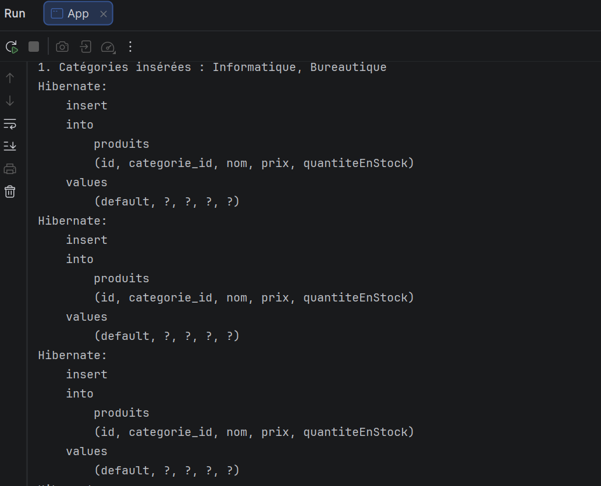
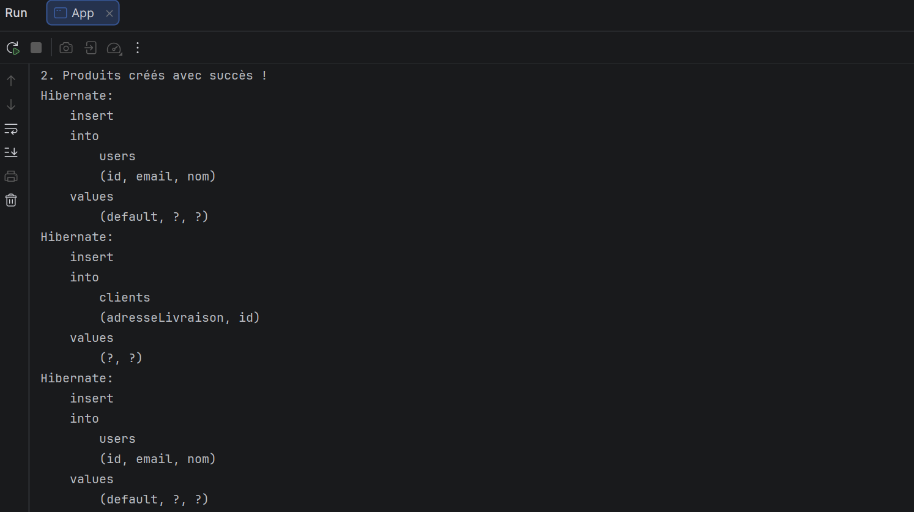
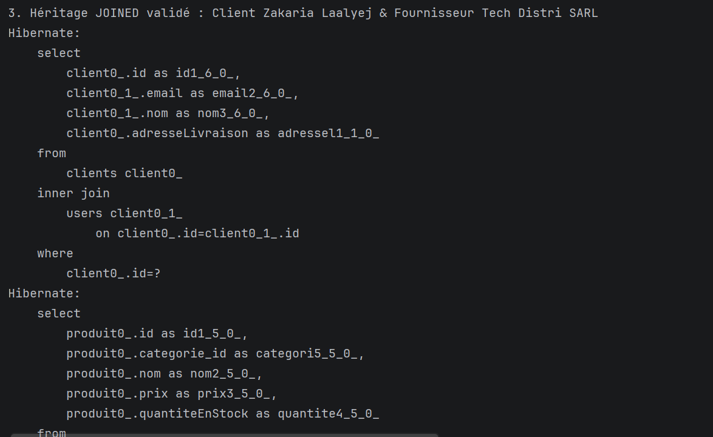
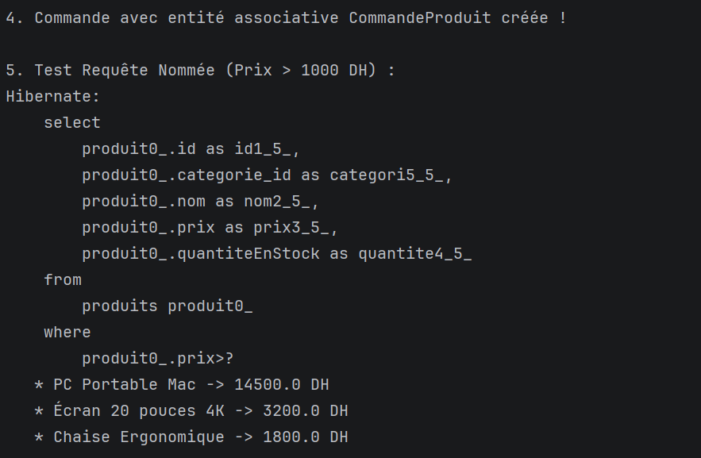
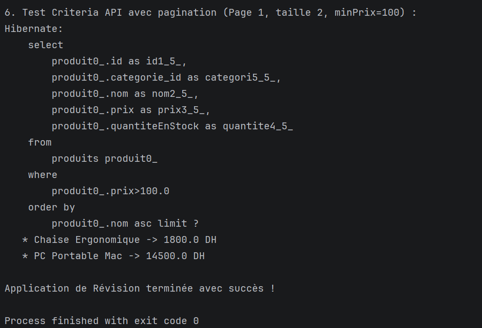

# Révision : Gestion commerciale avec Hibernate & JPA

**Réalisé par :** Zakaria Laalyej (2DSI)

Projet de révision réalisé dans le cadre du module JEE / Persistance des données avec Hibernate et JPA.
Il met en œuvre une application de gestion commerciale complète sur une base en mémoire H2 : architecture DAO
générique, héritage `JOINED` (User/Client/Fournisseur), relation N:N avec clé composite (`@EmbeddedId`),
requêtes nommées et requêtes dynamiques avec l'API Criteria paginée.

## Objectifs

- Développer un **`GenericDAO<T, ID>`** JPA robuste avec gestion explicite des transactions et libération des ressources.
- Modéliser une relation d'héritage normalisée avec la stratégie **`JOINED`**.
- Implémenter une relation Many-to-Many via une entité associative (`CommandeProduit`) portant des attributs et une clé primaire composite (`@EmbeddedId`).
- Définir et exécuter des **Named Queries** et des requêtes **Criteria API** avec filtrage dynamique, tri et pagination.

## Technologies

- Java 17
- Maven
- Hibernate 5.6 (JPA 2.2, `javax.persistence`)
- H2 (en mémoire)
- JUnit

## Modélisation des entités

```
         ┌───────────────┐
         │     User      │ (JOINED)
         └───────┬───────┘
           ▲           ▲
           │           │
     ┌─────┴────┐ ┌────┴────────┐
     │  Client  │ │ Fournisseur │
     └─────┬────┘ └─────────────┘
           │ 1
           │ *
     ┌─────┴────┐
     │ Commande │
     └─────┬────┘
           │ 1
           │ *
┌──────────┴───────────┐           ┌───────────┐
│   CommandeProduit    │ * ────── 1 │  Produit  │ ──── * [Categorie]
│ (id: CommandeId +    │           └───────────┘
│      ProduitId)      │
└──────────────────────┘
```

- **`User`** (classe mère abstraite), **`Client`** (`adresseLivraison`) et **`Fournisseur`** (`siret`) : stratégie `JOINED`.
- **`Categorie`** et **`Produit`** : relation One-to-Many (`@ManyToOne` / `@OneToMany`).
- **`CommandeProduit`** : entité associative avec clé composite `@EmbeddedId CommandeProduitPK`, reliant une commande et un produit avec une quantité et un prix unitaire au moment de l'achat.

---

## Captures d'exécution et analyse du SQL

Au lancement de `App`, Hibernate crée le schéma et exécute les différents scénarios de test (`hibernate.show_sql` et `hibernate.format_sql` activés).

### 1. Insertion des catégories et des produits



```sql
insert into produits (id, categorie_id, nom, prix, quantiteEnStock) values (default, ?, ?, ?, ?)
```

- Les catégories `Informatique` et `Bureautique` sont d'abord créées via le `GenericDAO`.
- Les produits sont ensuite persistés avec leur clé étrangère `categorie_id` reliant chaque produit à sa catégorie parente.

### 2. Héritage JOINED : Insertion de Client et Fournisseur



```sql
insert into users (id, email, nom) values (default, ?, ?)
insert into clients (adresseLivraison, id) values (?, ?)
insert into users (id, email, nom) values (default, ?, ?)
```

- Pour insérer une entité fille (`Client` ou `Fournisseur`), Hibernate insère d'abord une ligne dans la table mère `users` pour générer l'identifiant.
- Il insère ensuite les attributs spécifiques dans la table fille `clients` en réutilisant le même `id` comme clé primaire et clé étrangère.

### 3. Lecture polymorphique avec jointure (JOINED)



```sql
select
    client0_.id as id1_6_0_,
    client0_1_.email as email2_6_0_,
    client0_1_.nom as nom3_6_0_,
    client0_.adresseLivraison as adressel1_1_0_ 
from
    clients client0_ 
inner join
    users client0_1_ 
        on client0_.id=client0_1_.id 
where
    client0_.id=?
```

- Lors de la lecture d'un client, Hibernate effectue automatiquement un **`INNER JOIN`** entre `clients` et `users` pour reconstituer l'objet complet en mémoire sans perte de données.
- Le modèle relationnel est parfaitement normalisé (troisième forme normale 3NF).

### 4. Commande avec clé composite & Requête Nommée



```sql
select
    produit0_.id as id1_5_,
    produit0_.categorie_id as categori5_5_,
    produit0_.nom as nom2_5_,
    produit0_.prix as prix3_5_,
    produit0_.quantiteEnStock as quantite4_5_ 
from
    produits produit0_ 
where
    produit0_.prix>?
```

- La commande est enregistrée avec deux lignes `CommandeProduit` via la clé primaire composite `@EmbeddedId`.
- **Requête Nommée (`@NamedQuery`)** : `Produit.findByPriceGreaterThan` filtre les produits ayant un prix supérieur à 1000 DH.
- **Résultat obtenu :**
  - `* PC Portable Mac -> 14500.0 DH`
  - `* Écran 20 pouces 4K -> 3200.0 DH`
  - `* Chaise Ergonomique -> 1800.0 DH`
  - *(La souris sans fil à 250 DH est bien filtrée).*

### 5. Recherche Criteria API avec filtre, tri et pagination



```sql
select
    produit0_.id as id1_5_,
    produit0_.categorie_id as categori5_5_,
    produit0_.nom as nom2_5_,
    produit0_.prix as prix3_5_,
    produit0_.quantiteEnStock as quantite4_5_ 
from
    produits produit0_ 
where
    produit0_.prix>100.0 
order by
    produit0_.nom asc limit ?
```

- **Criteria API** : La requête dynamique filtre sur `prix > 100.0`, trie par nom alphabétique croissant (`order by produit0_.nom asc`) et limite le résultat aux 2 premiers éléments (`limit ?` correspondant à la page 1 de taille 2).
- **Résultat obtenu :**
  - `* Chaise Ergonomique -> 1800.0 DH`
  - `* PC Portable Mac -> 14500.0 DH`

---

## Architecture de l'application

- **`GenericDAO<T, ID>`** : classe générique fournissant les opérations CRUD standards (`create`, `update`, `delete`, `find`, `findAll`) avec isolation stricte des contextes de persistance.
- **`ProduitDAO`** : spécialisation de `GenericDAO` ajoutant les requêtes nommées et les requêtes dynamiques Criteria.
- **`CrudService<T, ID>`** : couche service déléguant les traitements métier au DAO.

---

## Structure du projet

```
revision-gestion-commerciale/
├── pom.xml
├── README.md
├── captures/
│   ├── 01-insertion-categories-produits.png
│   ├── 02-heritage-joined-insert-clients-users.png
│   ├── 03-lecture-jointure-client-user.png
│   ├── 04-requete-nommee-produits-chers.png
│   └── 05-criteria-api-pagination-tri.png
└── src/
    ├── main/
    │   ├── java/org/example/
    │   │   ├── App.java
    │   │   ├── dao/
    │   │   │   ├── GenericDAO.java
    │   │   │   └── ProduitDAO.java
    │   │   ├── entities/
    │   │   │   ├── Categorie.java
    │   │   │   ├── Client.java
    │   │   │   ├── Commande.java
    │   │   │   ├── CommandeProduit.java
    │   │   │   ├── CommandeProduitPK.java
    │   │   │   ├── Fournisseur.java
    │   │   │   ├── Produit.java
    │   │   │   └── User.java
    │   │   └── service/
    │   │       └── CrudService.java
    │   └── resources/META-INF/persistence.xml
    └── test/java/org/example/AppTest.java
```

## Lancer le projet

```bash
mvn clean compile exec:java -Dexec.mainClass="org.example.App"
```

## Auteur

Zakaria Laalyej, 2DSI, 2026
